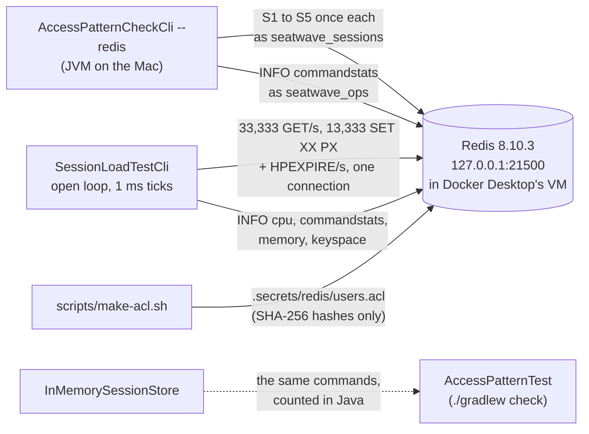

# Architecture

SeatWave's session store in Redis, built from its access patterns: two key families, a test that proves every pattern sends exactly its listed commands and no scan, an ACL that refuses anything else, and an open-loop load test at the estimated peak. Beside it, the JDK-only models and estimates behind the module's decision matrix for six workloads. This is the project of Module 15, "Beyond tables: choosing a database", of the course System Design Fundamentals.

## Packages

All code is under `io.plainround.seatwave.datastores`.

| Package | What it holds | Needs Redis |
|---|---|---|
| `sessions` | `FanSession` (the value, which validates itself, and its one-line stored form), `SessionKeys` (the two key families and the session id generator), `SessionStore` (the five access patterns as the only methods, the policy and the sealed refusals), `RedisSessionStore` (the patterns through Lettuce), `InMemorySessionStore` (a JDK-only model that sends and counts the same commands), `SessionAccessPattern` (the list: rate, p99 target, consistency, commands), `RedisSettings`, `ServerStats` (Redis's `INFO` numbers), `AccessPatternCheckCli`, `SessionLoadTestCli` | `RedisSessionStore` and the `--redis` paths of the two programs |
| `partitions` | `HotPartitionCli`: how each key choice spreads one second of the on-sale over 16 partitions | no |
| `history` | `WideColumnDemoCli`: booking history in a wide-column model, one table per query (Lab 3) | no |
| `catalog` | `CatalogDocumentCli`: the catalog document of one event (Lab 3) | no |
| `estimate` | `SizingCli`: the module's sizing of the six workloads, from stated inputs | no |

## The dependency rule

`sessions` depends on the JDK, result4j and Lettuce; only `RedisSessionStore`, `RedisSettings` and the two programs import Lettuce. `partitions`, `history` and `catalog` depend on the JDK only; `estimate` on `catalog`. Only the `*Cli` classes print or exit. `docs/decision-matrix.md` is the artifact the module's decision rests on; the programs print the numbers it quotes.

## Data flow

## Walk-through: one fan's session

1. Sign-in (S2): `HLEN seatwave:fan-sessions:<fanId>` against the limit of 10; `SET seatwave:session:<id> <value> NX PX <ms>`; `HSET` the fan index field; `HPEXPIRE` the field with the same milliseconds.
2. Every request (S1): `GET seatwave:session:<id>`; the value is parsed by `FanSession.fromStoredValue`, which refuses anything it did not write.
3. Every hold (S3): `SET ... XX PX <ms>`, which writes only if the key still exists, so a touch never revives a signed-out session; then `HPEXPIRE` slides the index field. Past the 12-hour lifetime the touch is refused with `LifetimeOver` and the session deleted.
4. Sign-out (S4): `DEL` and `HDEL`. Sign out everywhere (S5): `HKEYS` the fan index, one `DEL` per session (a Redis cluster refuses a multi-key `DEL` across slots), `DEL` the index.
5. Nothing cleans up: the session key and its index field expire on the same clock, in milliseconds.

## Decisions and trade-offs

- **`HPEXPIRE`, not the seed's `HEXPIRE`.** Lettuce sends a `Duration` to `HEXPIRE` in whole seconds, so the index field expired up to a second before its session, and at once when less than a second of the lifetime was left. The JDK-only model kept exact instants and could not show it; `RedisSessionStoreStackTest.aSessionAndItsIndexFieldExpireTogether` found it on the first stack run.
- **The ACL is the enforcement no code path can bypass.** `seatwave_sessions` may run the eight commands of S1 to S5 and `CLIENT SETINFO`, on the two key prefixes only. A Lettuce connection signs in with `HELLO 3 AUTH`, which needs no grant (checked by removing each grant in turn); `CLIENT SETINFO` is granted so each connection does not add a `NOPERM` error to Redis's counts. `seatwave_ops` may run `INFO` and `PING`, on no key.
- **Passwords in `.secrets/redis`, not `build/redis`.** `./gradlew clean` would delete the files while Redis reads them and the health check reads the monitoring password every 2 seconds. `scripts/stack.sh down` deletes them together with the Redis that used them.
- **One shared Lettuce connection.** Lettuce's connections are thread-safe and pipeline every thread's commands over one socket; the load test's virtual threads share one, as a SeatWave instance would.
- **An open-loop load test with a bounded in-flight count.** A call that finds no permit among 2,048 is counted as dropped, never queued, so the drop count shows when Redis or the path to it fell behind. Latency is measured from the due time.
- **The model and the store share a test, not a mock.** `AccessPatternTest` runs on the model in `./gradlew check`; `RedisSessionStoreStackTest` runs the same `runEveryPattern` against Redis with Redis's own counts, so the two cannot drift apart unnoticed.
- **No embedded stand-in for Redis.** The behavior taught (ACL refusals, key and field expiry, `INFO` counts) is Redis's own, so the stack tests run against the pinned image, outside `./gradlew check`.

## Invariants and where they are enforced

| Invariant | Enforced by | Proven by |
|---|---|---|
| Every listed access pattern is served by key lookups, never a scan | the Redis ACL (no `SCAN`, no `KEYS`, two key prefixes), `SessionStore`'s five methods | `AccessPatternTest` (model), `RedisSessionStoreStackTest.redisCountsExactlyTheListedCommandsForEveryPattern` and `theAclRefusesAScanToTheSessionService` (Redis), each mutation-checked |
| A touch never revives a signed-out session | `SET ... XX PX` in `RedisSessionStore.touch` | `InMemorySessionStoreTest` and `RedisSessionStoreStackTest.aTouchAfterSignOutIsRefusedAndDoesNotReviveTheSession` |
| The fan index never lists an expired session | the same milliseconds in `PX` and `HPEXPIRE` | `RedisSessionStoreStackTest.aSessionAndItsIndexFieldExpireTogether`, `InMemorySessionStoreTest` |
| No session lives past 12 hours | `Policy.allowsActivity` and `Policy.expiryAfter` | `PolicyTest`, `InMemorySessionStoreTest` |
| A fan has at most 10 sessions (a guard against abuse, not atomic) | `HLEN` before `SET NX` in `create` | `InMemorySessionStoreTest.refusesASignInBeyondThePerFanLimitAndKeepsTheOthers` |
| An invalid session, key or stored value cannot exist | `FanSession`'s compact constructor, `SessionKeys`, `fromStoredValue` | `FanSessionTest`, `SessionKeysTest` |
| Settings problems are reported together, as values | `RedisSettings.fromEnvironment`, `LoadSettings.fromEnvironment` | `SettingsTest` |
| Nothing of the project is left after a run | `scripts/stack.sh down` | its own check, and the listings in the README |
